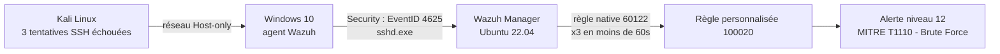
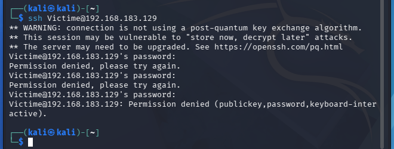
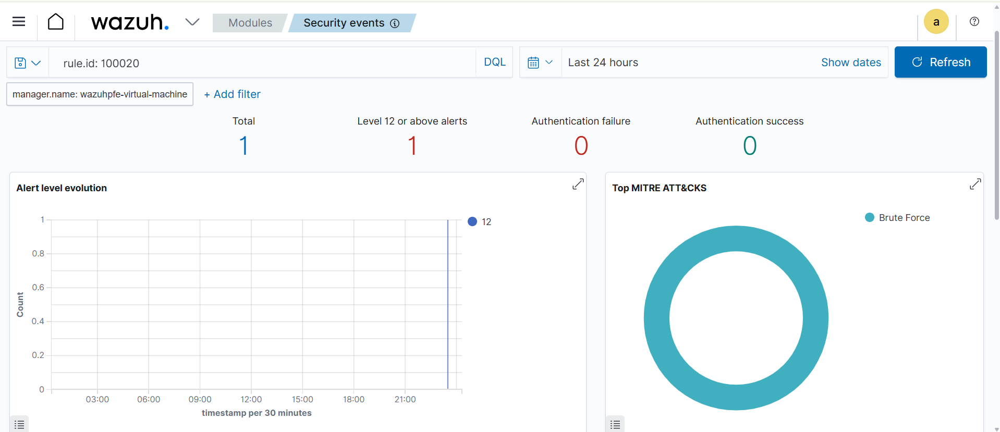

# Wazuh Custom Rules : détection d'un brute force SSH avec mapping MITRE ATT&CK

Règle de corrélation Wazuh personnalisée qui détecte une attaque par brute force SSH (plusieurs échecs de connexion rapprochés) et la rattache automatiquement à la technique MITRE ATT&CK **T1110 (Brute Force)**.

## Objectif

Par défaut, Wazuh génère une alerte de faible niveau pour **chaque** échec de connexion isolé. Un analyste SOC a besoin de distinguer un échec ponctuel (mot de passe oublié) d'une véritable attaque (plusieurs tentatives rapprochées). Ce projet ajoute une règle de corrélation qui élève le niveau d'alerte et l'enrichit avec le contexte MITRE ATT&CK dès que le seuil d'une attaque est atteint.

## Architecture



**Laboratoire :** réseau VMware Host-only isolé.
- Serveur Wazuh 4.7.5 : Ubuntu 22.04 LTS
- Machine cible : Windows 10, agent Wazuh + serveur OpenSSH
- Attaquant : Kali Linux

## Démarche

1. **Diagnostic de la chaîne de bout en bout.** Avant d'écrire la règle, j'ai vérifié chaque maillon : connectivité réseau agent/serveur, synchronisation de l'adresse du manager dans `ossec.conf`, collecte du canal `Security` par l'agent Windows, puis confirmation que l'événement Windows **ID 4625** (échec de connexion) remonte bien jusqu'au serveur Wazuh pour une tentative SSH (`processName: sshd.exe`).
2. **Identification de la règle native déclenchée** : Wazuh classe chaque échec SSH individuel sous la règle **60122** (*Logon failure - Unknown user or bad password*, niveau 5).
3. **Écriture d'une règle de corrélation** dans `local_rules.xml`, qui se déclenche uniquement si la règle 60122 apparaît 3 fois en moins de 60 secondes pour la même machine, et qui ajoute le mapping MITRE ATT&CK.

## Règle Wazuh (`local_rules.xml`)

```xml
<rule id="100020" level="12" frequency="3" timeframe="60">
  <if_matched_sid>60122</if_matched_sid>
  <description>Brute force SSH detecte : 3 echecs de connexion en moins d'une minute sur $(win.system.computer)</description>
  <mitre>
    <id>T1110</id>
  </mitre>
  <group>authentication_failures,brute_force,mitre_t1110</group>
</rule>
```

Le fichier complet est dans [`local_rules.xml`](local_rules.xml).

## Test et validation

Depuis Kali, 3 tentatives SSH avec un mauvais mot de passe en moins d'une minute :
```bash
ssh victime@<IP_machine_cible>
```

**Résultat obtenu sur le serveur Wazuh :**

```
2026-10-27T00:30:09 | rule id: 60122 | level: 5  | Logon failure - Unknown user or bad password.
2026-10-27T00:30:10 | rule id: 60122 | level: 5  | Logon failure - Unknown user or bad password.
2026-10-27T00:30:11 | rule id: 100020 | level: 12 | Brute force SSH detecte : 3 echecs de connexion en moins d'une minute sur DESKTOP-8F90A5A
```

Détail de l'alerte 100020 :
```json
{
  "level": 12,
  "description": "Brute force SSH detecte : 3 echecs de connexion en moins d'une minute sur DESKTOP-8F90A5A",
  "id": "100020",
  "mitre": {
    "id": ["T1110"],
    "tactic": ["Credential Access"],
    "technique": ["Brute Force"]
  },
  "frequency": 3,
  "firedtimes": 1
}
```

Les 3 échecs isolés (niveau 5) ne déclenchent aucune action particulière ; la 3ᵉ répétition en moins d'une minute fait remonter une alerte unique de niveau 12, correctement associée à la tactique **Credential Access** et à la technique **Brute Force (T1110)**.

## Captures d'écran

**Tentative d'attaque depuis Kali (3 échecs SSH) :**



**Alerte détectée dans Wazuh, niveau 12, technique MITRE Brute Force :**



## Ce que j'ai appris

- Diagnostiquer une chaîne SIEM de bout en bout (réseau, agent, décodeur, règle) plutôt que de supposer qu'une alerte manquante vient forcément de la règle.
- La différence entre une alerte native Wazuh et une règle de corrélation (`frequency` / `timeframe` / `if_matched_sid`), qui transforme un volume d'événements bruts en un incident exploitable.
- L'enrichissement MITRE ATT&CK directement dans une règle Wazuh (`<mitre><id>`), plutôt que seulement au niveau applicatif comme dans la plateforme SOC-GRC de mon PFE.

## Prochaines améliorations possibles

- Ajouter une réponse active (`active-response`) qui bloque automatiquement l'adresse IP source après déclenchement de la règle 100020.
- Étendre la règle pour couvrir aussi les échecs de connexion RDP et les journaux Linux (`sshd` natif).

## Avertissement

Projet réalisé dans un laboratoire isolé (réseau VMware Host-only). Aucune donnée réelle, secret ou information d'entreprise n'est publié dans ce dépôt.
